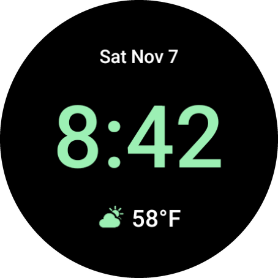
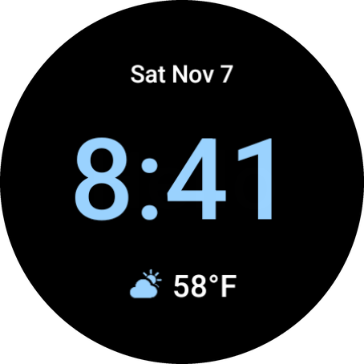
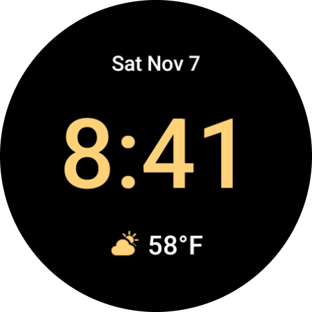
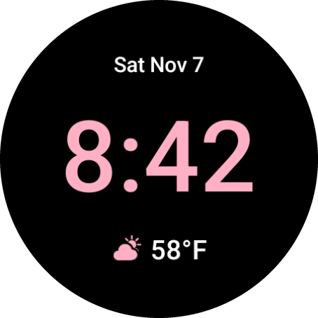
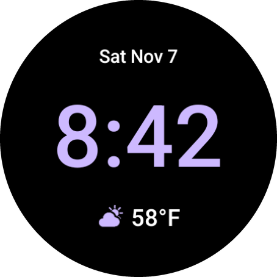
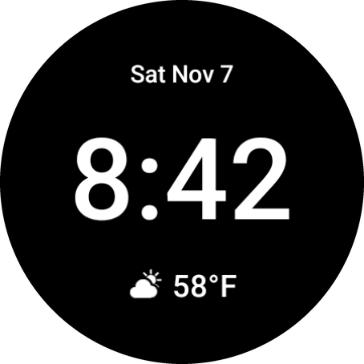
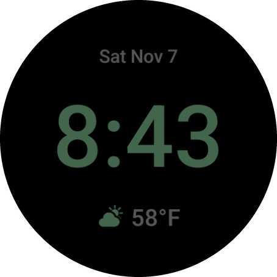

# Utility Classic

A personal Pixel Watch 5 face styled after Google's Utility face: the date at the top, large digital
time in the middle, and the current weather icon and temperature below.

<p align="center">
  
</p>

Built with Watch Face Format 2 (the lowest version with weather data), so it contains no app code.

## Screenshots

### Colors

The color setting changes the time and the weather icon. The date and temperature stay white.

| Mint (default) | Sky | Amber |
|:---:|:---:|:---:|
|  |  |  |

| Rose | Lavender | White |
|:---:|:---:|:---:|
|  |  |  |

### Always-on display



These were rendered on a Wear OS 7 emulator using test builds with the color and weather fixed, so
the 58°F reading is sample data.

## Install on the watch

The watch and Mac need to be on the same Wi-Fi network.

1. On the watch, open **Settings > System > About > Versions** and tap **Build number** seven times.
2. Open **Settings > Developer options** and turn on **ADB debugging** and **Wireless debugging**.
3. In **Wireless debugging**, choose **Pair new device**, then run this with the values it shows:

   ```sh
   ~/Library/Android/sdk/platform-tools/adb pair <ip>:<pairing-port> <code>
   ```

4. Run this with the IP and port on the main **Wireless debugging** screen, which differ from the
   pairing port:

   ```sh
   ./install.sh <ip>:<connect-port>
   ```

Turn wireless debugging off afterward to save battery. The face stays installed.

## Customize

Long-press the face and tap **Edit** to change the color.

For layout changes, edit `tools/generate.py`, not `res/raw/watchface.xml`, then run `./build.sh`.
Rebuilding needs a Python with Pillow, set through `PYTHON=/path/to/python`. Updates must be signed
with the same key, kept at `~/.android/utility-classic.keystore`.

## Weather

Weather comes from the watch's own weather service. If it has no data, the face shows
"Weather unavailable" until it does.
